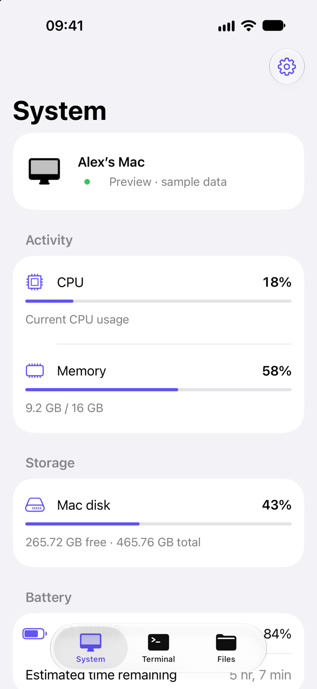
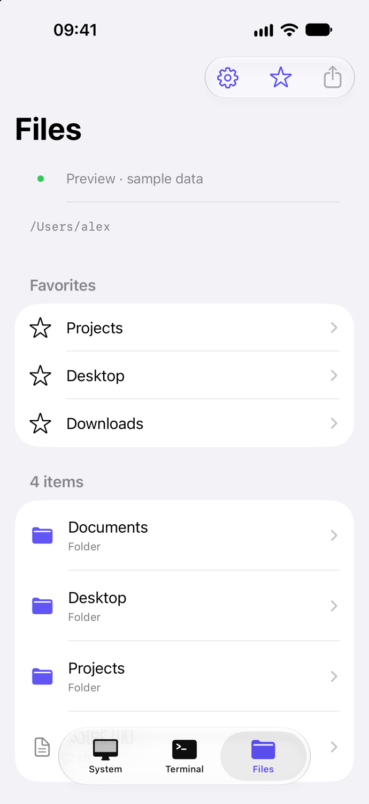

# MacCommand

Check your Mac’s system status, transfer files, and run terminal commands from your iPhone. Connect over Wi-Fi or cellular data. Encrypted requests travel through your own iCloud account.

**[Download the previous 3.1 Mac beta](https://github.com/eminaydin19/MacCommand/releases/download/v3.1.0/MacCommand-3.1-CloudKit.dmg)** · [3.1 beta release notes](https://github.com/eminaydin19/MacCommand/releases/tag/v3.1.0)

Requires Apple Silicon and macOS 14 or later. The iPhone app is available through an invitation-only TestFlight beta for iOS 17 or later. Version 3.1.1 uses an English interface on iPhone and Mac. Its source is available below, and the English app packages are pending distribution. The previous 3.1 download uses Turkish.

  
  &nbsp;&nbsp;
  

Version 3.1.1 · iPhone Simulator · sample data

## Get connected

1. Open the DMG on your Mac. Drag **MacCommand** into **Applications** and launch it.
2. Install MacCommand on your iPhone using your TestFlight invitation. Sign in to the same iCloud account on both devices.
3. Open the pairing QR code in the Mac app. Scan it with the iPhone app and confirm the connection.

Your Mac must be awake and online. You can disable access or reset pairing from the Mac menu bar.

## Files and terminal

- **System status.** View your Mac’s CPU, memory, and disk usage.
- **Files.** Save frequently used folders as favorites. Download files from your Mac or send a file from your iPhone’s share sheet. Each file can be up to 50 MiB.
- **Terminal.** Unlock with Face ID or your device passcode. Commands run with the permissions of the user signed in on the Mac. Output appears when the command finishes. Stop requests may take time to reach the Mac.

[Build and CloudKit setup](docs/build.md) · [MIT license](LICENSE)
