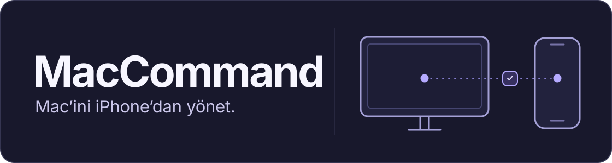

# MacCommand

Mac’in sistem durumuna bak, dosya aktar ve terminal komutları çalıştır. MacCommand, eşleştirdiğin cihazlar arasında şifreli istekleri iCloud üzerinden taşır. Mac’in çevrimiçiyken iPhone’dan Wi‑Fi veya mobil internetle bağlanabilirsin.

**[Mac için DMG’yi indir](https://github.com/eminaydin19/MacCommand/releases/download/v3.1.0/MacCommand-3.1-CloudKit.dmg)** · [3.1 beta sürüm notları](https://github.com/eminaydin19/MacCommand/releases/tag/v3.1.0)

macOS 14+ · Apple Silicon · iOS 17+ · Davetli TestFlight betası

## iPhone’da MacCommand

  
  &nbsp;&nbsp;
  

iPhone uygulaması · Simülatörde örnek verilerle çekildi

- **Sistem.** İşlemci, bellek ve disk kullanımına göz at.
- **Dosyalar.** Favori klasörlerini aç, Mac’ten dosya indir veya iPhone’un paylaş menüsünden **Mac’e Gönder**. Tek dosya sınırı 50 MiB.
- **Terminal.** Face ID veya cihaz parolasıyla aç ve komut çalıştır. Çıktı komut tamamlandığında görünür. Durdurma isteğinin Mac’e ulaşması zaman alabilir.

## İlk bağlantı

1. Mac’te DMG’yi aç, **MacCommand**’i **Uygulamalar** klasörüne taşı ve çalıştır.
2. iPhone’a TestFlight davetinden **MacCommand 3.1**’i yükle. İki cihazda da aynı iCloud hesabıyla oturum aç.
3. Mac’te **iPhone eşleştir**’e bas, iPhone ile QR kodu tara ve **Mac’e bağlan**’ı seç.

Bağlantı için Mac açık, uyanık ve çevrimiçi olmalı. Menü çubuğundan erişimi kapatabilir veya eşleştirmeyi yenileyebilirsin. Terminal komutları Mac’te oturum açmış kullanıcının yetkileriyle çalışır.

## Kaynak kod

[Derleme ve CloudKit kurulumu](docs/build.md) · [MIT lisansı](LICENSE)
